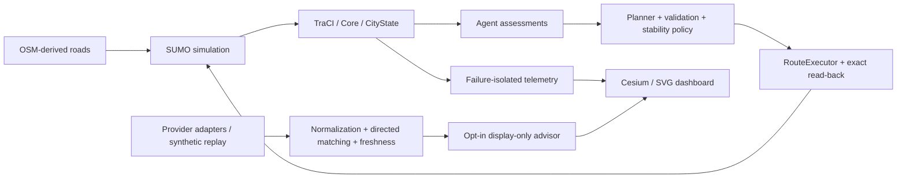

# CityBrain

**AI-Based Emergency Response Coordination and Dynamic Traffic Recalculation Using a Digital Twin**

CityBrain is a university research software prototype for observing simulated traffic, coordinating an ambulance response, reassessing routes and verifying route execution. It combines an OSM-derived Chennai study corridor, SUMO microscopic simulation, CityBrain Core and specialized agents, an existing planner/validator, and a Cesium/SVG dashboard.

A route may become unsuitable after dispatch. CityBrain evaluates the remaining route, applies a validated replacement through TraCI when justified, and reads the physical route back from SUMO before logical acceptance. A 20-second Chennai confirmation guard limits soft-change churn; confirmed hard invalidations retain immediate handling.

**Current completion evidence:** [Final project status](docs/FINAL_PROJECT_STATUS.md) · [Demo readiness](docs/FINAL_DEMO_READINESS.md) · [Academic submission package](deliverables/final-academic-submission/).

## V4 extension — separate local live-data prototype

V3 below is preserved. The additive [V4 implementation PR #11 (merged)](https://github.com/arghsahai/CityBrain/pull/11) provides public **test** incident reporting, authenticated local operator review, USER_SELECTED ambulance pins, bounded directed routing, offline traffic reassessment and facility-scoped staff-report testing. It runs without SUMO, has no authorized provider connection, and recommends routes without executing them. This is not an emergency service.

[Setup](docs/V4_LIVE_DATA_SETUP.md) · [Actual status and testing gaps](docs/V4_FEATURE_STATUS.md) · [Architecture](docs/V4_ARCHITECTURE.md) · [Demos](docs/V4_DEMO_SCRIPT.md) · [Security/privacy](docs/V4_SECURITY_AND_PRIVACY.md). A new follow-up verifies the offline browser workflow and fixes Cesium display defects; see [20 October synchronization and validation](docs/V4_SYNCHRONIZATION_20261020.md). Remaining browser/operational gates are documented; the follow-up PR stays draft. Do not use it for actual emergency operations.

## What is implemented

- Chennai-area OSM road geometry and geographic projection, SUMO background vehicles, ambulance movement, simulated incidents, configured hospitals and signal telemetry.
- Shared CityState, Traffic/Ambulance/Hospital/Police/Signal agent assessments, EmergencyPlanner, RouteScorer, PlanValidator and ReplanningPolicy.
- Verified route execution, exact active-suffix read-back, failure recovery and terminal cleanup. Teleports and unexplained disappearance do not count as successful arrival.
- Cesium visualization, SVG/2D fallback, replay controls, route/vehicle alignment, source/freshness labels and a consented tab-local location marker.
- HERE/TomTom adapters and synthetic traffic replay. The opt-in advisor is display-only and cannot change planner costs, trigger production replanning or commit routes.
- Preserved research evidence, including the original 180 trials and the separate V3.1 60-cell matched SUMO study.



Road geography is OSM-derived. Traffic, demand, incidents, signals and hospital availability are simulated. Police recommendations are logical advisories, not physical police dispatch. Signal recommendations are not actuated. No genuine HERE/TomTom response or live Chennai coverage is verified. SUCCESS means arrival at a configured simulated hospital access road, not clinical admission or driveway validation.

## Setup

Final QA used **Python 3.13.5, SUMO 1.27.1 and Chrome 155 on macOS**. Install SUMO separately and ensure `sumo` is on PATH (or configure `SUMO_HOME` and PATH). A WebGL-capable browser supports 3D; SVG/2D works as a fallback. No credentials, paid API or cloud account is needed.

These shell commands are for macOS/Linux from the repository root; the POSIX launcher was tested on macOS. Windows was not exercised in final QA. The Python modules are available after configuring Python and SUMO, but no untested Windows setup is claimed. The safe archive-extraction command below requires Python 3.12+.

```sh
python3 -m venv venv
venv/bin/python -m pip install -r requirements-chennai.txt
venv/bin/python -c "import sumolib, traci, pyproj"
sumo --version
```

See [setup details](docs/V3_SETUP.md) and [troubleshooting](docs/V3_TROUBLESHOOTING.md). The checked-in Chennai network is used; no OSM download or provider request is needed for the demo.

## Demo A — normal Chennai response

```sh
./tools/run_chennai.sh --mode simulation --seed 17
```

Open the printed URL (default `http://127.0.0.1:8770`). Observe the simulated emergency, dispatch, accepted P0, moving ambulance, hospital and signals. The verified seed-17 run reaches SUCCESS at **704 simulation seconds**: dispatch 51 s, travel 653 s, **zero route changes**. This is a successful-response demo, not evidence of an applied replan. The default pace takes about four minutes. Ctrl-C closes the launcher and its child connection/server.

For the synthetic traffic sidecar and optional display-only evaluator:

```sh
./tools/run_chennai.sh --mode replay-assisted --experimental-traffic-evaluation --seed 17
```

This mode still runs SUMO; its external traffic input is `REPLAY / SYNTHETIC_SAMPLE`. It is not live Chennai traffic. A completed Chennai output can be replayed without launching a new SUMO process:

```sh
venv/bin/python -m citybrain.chennai --mode replay --events /path/to/completed-chennai-output --port 8773 --no-browser
```

Open `http://127.0.0.1:8773`. Use the timeline, including 61 s for guarded KEEP and 704 s for terminal SUCCESS. At completion, the inactive ambulance is not displayed as a current vehicle fix.

## Demo B — verified dynamic replanning, separate saved S08 grid run

This is the preserved synthetic grid integration demo, **not the Chennai run or a test of its 20-second guard**. Its saved evidence contains exact execution read-back before P0/P1/P2 acceptance at **301/311/316 s**, followed by SUCCESS at **425 s** and 124 s travel. The original generated input hashes are preserved; those input files are not in this compact archive and cannot be recomputed from it.

Verify the archive, extract it into a unique temporary directory and start a read-only viewer:

```sh
venv/bin/python tools/verify_saved_replan.py
DEMO_B_DIR="$(mktemp -d /tmp/citybrain-replan.XXXXXX)"
venv/bin/python -c "import sys,tarfile; tarfile.open('docs/krishna/s08-3d-demo-evidence.tar.gz').extractall(sys.argv[1],filter='data')" "$DEMO_B_DIR"
venv/bin/python -m citybrain.dashboard --events "$DEMO_B_DIR/runtime/events.jsonl" --scenario 'SAVED SYNTHETIC S08 GRID — not Chennai' --port 8778 --replay
```

Open `http://127.0.0.1:8778/3d` and seek 301 → 311 → 316 → 425. The ordinary 2D dashboard is at `/`. This replay launches no simulator. Ctrl-C stops the viewer. See the [five-minute walkthrough and two-minute fallback](deliverables/final-academic-submission/FINAL_DEMO_CHECKLIST.md).

## Tests and non-research smoke checks

Use unique output paths. Do not run a full research matrix for a presentation.

```sh
venv/bin/python -m pytest -q
for script in test_ambulance_agent.py test_emergency_planner.py test_hospital_agent.py test_models.py test_plan_validator.py test_police_agent.py test_replanner.py test_route_scorer.py test_signal_agent.py test_traffic_agent.py; do venv/bin/python "$script" || break; done
./tools/run_chennai.sh --mode simulation --seed 17 --seconds-per-step 0 --no-server --no-browser --exit-on-complete --output /tmp/citybrain-new-smoke-UNUSED
venv/bin/python -m citybrain.chennai.validate --run /tmp/citybrain-new-smoke-UNUSED
venv/bin/python -m citybrain.chennai.validate --historical
```

Final QA: **447 pytest tests passed**, all ten compatibility scripts passed; both fresh simulation and replay-assisted smokes reached SUCCESS at 704 s; all **2,172 historical manifest entries** matched. Chrome checks covered 3D/SVG, movement, signals, route alignment, guard, closure lifecycle, timestamp recovery, source labels and 800/390 px layouts. [Evidence summary](docs/final-qa-evidence/validation.json).

## Research results and limits

The separate preregistered V3.1 study contains 60 synthetic trials: three scenarios × ten matched seeds × static/dynamic arms.

| Scenario | Static SUCCESS | Dynamic SUCCESS | Paired successful response-time comparison |
|---|---:|---:|---|
| S05 | 7/10 | 10/10 | Seven pairs; mean/median difference 0 s |
| S06 | 0/10 | 0/10 | None; both arms teleported in every run |
| S08 | 0/10 | 10/10 | None; no successful static pairs |

Teleports remain failures in denominators. The small, synthetic study does not establish universal superiority or real-world benefit. It does not evaluate live providers or the display-only advisor. [Analysis](data/output/v3-experiments/v31-matched-sumo-10seed-20261018/v31-analysis.md) · [Protocol](docs/V31_EXPERIMENT_PROTOCOL.md). The original 180-trial evidence is separate and preserved; its [historical experiment guide](docs/HISTORICAL_EXPERIMENT_README.md) documents older harness conventions.

## Submission and boundaries

The [final package](deliverables/final-academic-submission/) contains the 12-slide editable PowerPoint, DOCX/PDF report, fresh Chennai replay screenshot, saved-replanning screenshot, demo scripts and viva guide. [Current feature matrix](docs/FINAL_PROJECT_STATUS.md) distinguishes verified features from advisory, unverified and out-of-scope capabilities.

CityBrain has no real-camera accident detection, physical signal controller, clinical capacity feed or production emergency-response safety certification. Browser geolocation requires user consent and stays in tab memory. Provider requests require separate explicit authorization; none is authorized by these instructions.
