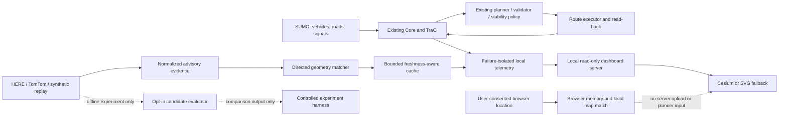

# CityBrain V3.0 prototype architecture

## Runtime and data flow

## Authority boundaries

SUMO and the existing Core provide canonical vehicle, road and signal state.
The existing planner, validator, Chennai 20-second soft-change guard, hard-failure
path, route executor and physical read-back remain the only route commitment path.
Provider observations remain advisory; the optional evaluator produces a separate
candidate cost comparison and is disabled by default. It neither mutates canonical
measurements nor calls the planner or executor. The browser GPS marker is kept in
the tab and never enters the runtime.

## Provenance labels

| Label | Meaning |
|---|---|
| `SUMO_SIMULATED` | Ground-truth state observed from the local SUMO simulation |
| `SYNTHETIC_SAMPLE` | Invented fixture used to exercise the offline traffic pipeline |
| `REPLAY` | Recorded observations shown from a saved file; not live |
| `MOCKED_PROVIDER` | Test-only provider response |
| `HERE_LIVE` / `TOMTOM_LIVE` | Genuine adapter response only; unavailable until explicitly authorized and observed |
| `CONSENTED_DEVICE_LOCAL` | Browser geolocation held in tab memory; never a SUMO vehicle state |

Unknown, stale, expired, unmatched and ambiguous evidence remains visibly distinct.
No genuine provider response was obtained during this implementation.
