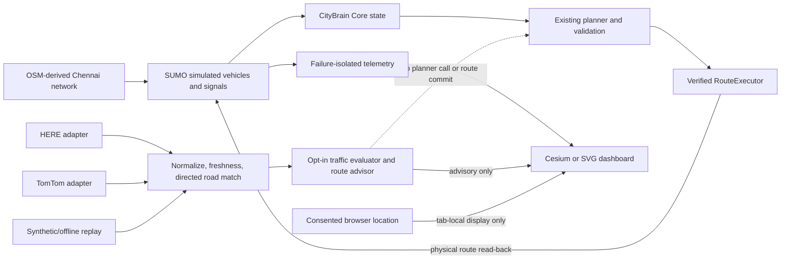

# CityBrain V3.1 implementation report

Date: 2026-10-18. This report describes a software research prototype, not an
emergency-response service.

## Architecture and feature state

| Capability | State in this branch | Can affect route execution? |
|---|---|---|
| OSM-derived Chennai road network and SUMO demand | Implemented; simulation verified | SUMO is the simulated physical truth |
| Existing CityBrain planner and verified RouteExecutor | Preserved; Core/planner code unchanged by V3.1 | Yes, through the existing runtime path |
| 20-second Chennai soft-change confirmation guard | Preserved | Gates soft replans; hard invalidations retain handling |
| HERE/TomTom/replay ingestion and normalization | Adapters and replay implemented; live credentials/responses absent | No |
| External-traffic evaluator and connected-candidate advisor | Opt-in; default off; freshness, match, direction, confidence, coverage, bounds, improvement, commitment, cooldown and route-history gates | No; display-only suggestion |
| SUMO signals | Phase/link telemetry and advisory suggestions | No signal-phase writes; priority controller disabled |
| Browser location | User-consented tab-local marker | No |
| Local GPS runtime feed | Not added; browser marker is sufficient for this demonstration | No |
| Cesium and SVG dashboard | Implemented; browser checks passed | Isolated from simulator correctness |
| Formal comparison study | 60 matched synthetic SUMO trials across S05/S06/S08, static/dynamic | Legacy planner arms only; not traffic-assisted |

The core control path is `CityBrainRuntime` → planner validation → verified
`RouteExecutor` → SUMO route read-back → logical plan acceptance. The data view
and experimental advisor are sidecars. Provider observations remain separate
from canonical `CityState` and planner costs.



## Validation evidence

Baseline revision was `368a83c041e171f664b8bb156b785aeedd4f9d65`; the branch was
clean, matched its origin ref and was based on `origin/main`. PR #10 was open and
Draft, targeting `main`. V3.1 milestones were committed and pushed individually;
see the branch history and the PR for exact SHAs.

At baseline, **437 pytest tests**, all ten legacy compatibility scripts and the
read-only historical manifest validator passed. The preregistered comparison
contains 60 complete trial rows after resuming the preserved partial outputs
following an aggregation-only runner fix. Outcomes and matched-success
uncertainty are in [`v31-analysis.md`](../data/output/v3-experiments/v31-matched-sumo-10seed-20261018/v31-analysis.md)
and its JSON companion. Do not interpret N=10 cells as proof of superiority.

The checked-in seed-1 S05/S06/S08 baseline summary remains a smoke package, not a
formal effect estimate. A fresh seed-17 default simulation reached SUCCESS at
704 simulated seconds (dispatch 51 s; 653 s travel), with zero telemetry and
dashboard write failures. The final opt-in advisor simulation and final full
pytest/compatibility checks are recorded in the delivery report after exit
statuses have been verified.

The browser replay review used Chrome 155 and recorded zero page errors. It
verified observed moving vehicles, route geometry, signal states, guarded KEEP,
synthetic traffic labels, external 3D/SVG overlays, selected-road comparison,
UNKNOWN/EXPIRED labels, closure markers `1 → 0 → 1`, future timestamp quarantine
and recovery, 800-pixel layout, and mocked advisor evidence rendered as
display-only. Mock fixtures do not establish live provider behavior.

The network exposes two SUMO traffic lights and fixed programs with 4 and 14
controlled connection entries. Program phase `minDur`/`maxDur` values are unset;
there is no reviewed movement/phase compatibility, required all-red clearance,
or tested restoration contract. Priority remains advisory. The runtime GPS feed
was deliberately not added: the existing local consented marker suffices and
does not add a coordinate receiver or transport.

No HERE or TomTom API was called. Adapters are present but not live-verified;
coverage, accuracy, cost and account limits for a real VIT Chennai corridor are
unverified. Live traffic, clinical hospital capacity, real signal timing and
production safety remain external blockers.

## Reproduction commands

```sh
# Opt-in replay-assisted dashboard; uses local replay and no provider requests.
./tools/run_chennai.sh --mode replay-assisted --experimental-traffic-evaluation

# Fast headless simulation smoke in a fresh path.
./tools/run_chennai.sh --mode simulation --seed 17 --seconds-per-step 0 \
  --no-server --no-browser --exit-on-complete --output /tmp/citybrain-v31-sim
venv/bin/python -m citybrain.chennai.validate --run /tmp/citybrain-v31-sim

# Read-only historical integrity check.
venv/bin/python -m citybrain.chennai.validate --historical

# Preregistered ten-seed paired SUMO study (never run into experiments/results).
venv/bin/python -m experiments.runners.compare --scenarios S05 S06 S08 \
  --profiles normal --seeds 1 2 3 4 5 6 7 8 9 10 \
  --output data/output/v3-experiments/v31-matched-sumo-10seed-20261018
venv/bin/python tools/analyze_v31_experiment.py
```

The faculty presentation timing and offline fallback instructions are in
[`V31_DEMO_SCRIPT.md`](V31_DEMO_SCRIPT.md). Remaining viva questions are in
[`V31_VIVA_QA.md`](V31_VIVA_QA.md). Provider setup requires genuine credentials
and separate explicit authorization before any network request.
